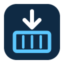

# PullEmUp

Browse the container images in all your registries from one desktop app: AWS ECR, Azure ACR, GitHub Container Registry, Docker Hub and any OCI registry. PullEmUp uses the logins already on your machine and is read-only.

This repository hosts **installers and release notes only**; it is the public download point for PullEmUp. Source code is developed elsewhere, and builds are published here as [GitHub Releases](../../releases).

## Download

Grab the latest installer for your platform from the [Releases page](../../releases/latest):

| Platform | File |
|---|---|
| Windows | `PullEmUp_<version>_x64-setup.exe` |
| Linux | `PullEmUp_<version>_amd64.deb`, `.rpm`, or `.AppImage` |

## Which logins it uses

PullEmUp finds registries through the tools you already use and never stores credentials itself:

| Registry | Log in with |
|---|---|
| AWS ECR | AWS profiles in `~/.aws` (access keys, SSO, `credential_process`), e.g. `aws configure sso` |
| Azure ACR | The Azure CLI: `az login` (az must be installed) |
| GitHub Container Registry | `gh auth login -s read:packages`, a `GH_TOKEN`, or `docker login ghcr.io` |
| Docker Hub | `docker login -u <username>` with a personal access token |
| Other registries | `docker login <host>` or `podman login <host>` |

Registries it can't find on its own (a public registry, or an Azure registry you can pull from but can't see in your subscription) can be added by hand in **Sources**.

## Changelog

See [CHANGELOG.md](CHANGELOG.md) for release history.

## License

[MIT](LICENSE)
